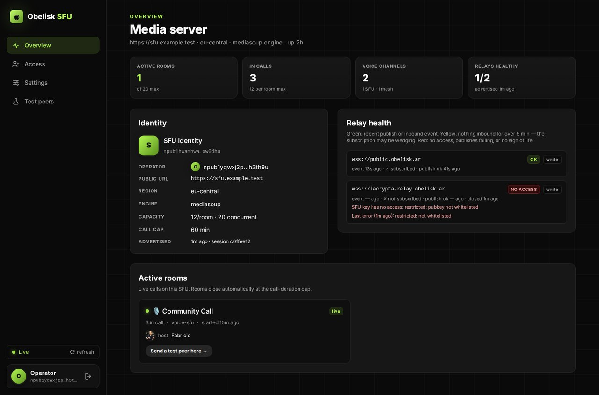
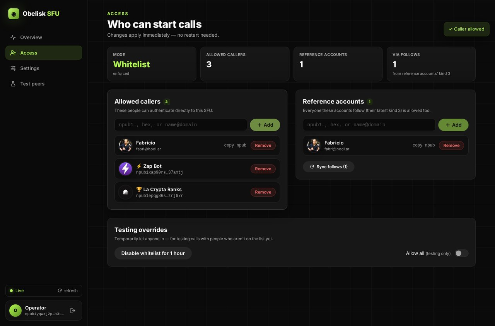
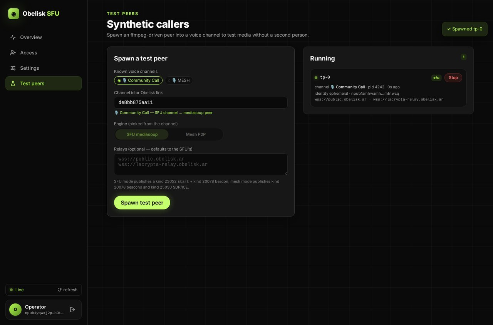
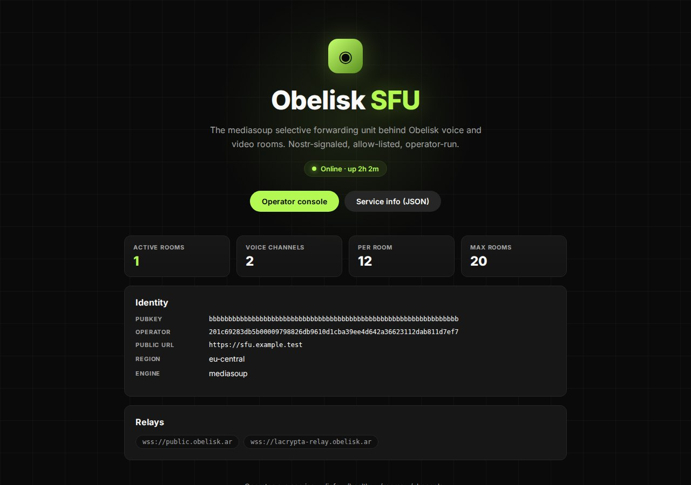

<div align="center">



<p>
  <a href="https://github.com/obelisk-app/obelisk-sfu/stargazers"></a>
  <a href="https://github.com/obelisk-app/obelisk-sfu/commits/main"></a>
  <a href="https://github.com/obelisk-app/obelisk-sfu/graphs/commit-activity"></a>
</p>
<p>
  
  
  
  
  
</p>

<h3>
  <a href="https://obelisk.ar">🗿 Obelisk</a>
  &nbsp;·&nbsp;
  <a href="#-run-your-own">🛠️ Run your own</a>
  &nbsp;·&nbsp;
  <a href="docs/RUNBOOK.md">📖 Operator runbook</a>
  &nbsp;·&nbsp;
  <a href="DEPLOY.md">🚀 Deploy</a>
  &nbsp;·&nbsp;
  <a href="docs/sfu-system.md">📐 Architecture</a>
</h3>

</div>

**Obelisk SFU** is an operator-run [mediasoup](https://mediasoup.org) service for [Obelisk](https://obelisk.ar)'s `voice-sfu` channels. Peer-to-peer mesh calls fall apart past a handful of people, because everyone uploads to everyone. With an SFU, each person sends **one** stream up and the SFU forwards it to everyone else in the room.

There are no accounts and no passwords. Browsers prove who they are with a **signed Nostr identity**, and the SFU only lets in callers it has allow-listed. Nostr carries the channel pin, discovery and room status. Media goes straight from the browser to the SFU, never through a relay.

<div align="center">
  
  <sub>A <code>voice-sfu</code> channel in Obelisk, with a synthetic test peer streaming through the SFU.</sub>
</div>

## 📞 How a call connects

<div align="center">
  
</div>

| Path | Transport | Purpose |
|---|---|---|
| Channel selection | Nostr kind **30078** | A channel admin pins one SFU URL. Before publishing, the client verifies it through `/info`. |
| Service descriptor | HTTPS `GET /info` | SFU pubkey, operator, capacity, region and fallback relays. CORS-enabled. |
| Authentication + RPC | `wss://<sfu>/rpc?channelId=<id>` | The browser signs a kind **22242** challenge, then exchanges mediasoup requests over the socket. |
| Media | WebRTC ICE / DTLS / SRTP | Browser ↔ mediasoup over UDP or TCP. Never through a relay or the HTTPS tunnel. |
| Discovery / status | kinds **31313** / **31314** | Optional SFU discovery and active-room status. |
| Compatibility | kinds **25052** / **25050** | Start and RPC fallback for older clients and SFUs. |

A `voice-sfu` channel never silently falls back to a mesh room when its SFU is down. The full spec is in [docs/sfu-system.md](docs/sfu-system.md).

## 🔐 Who gets in

A caller on `/rpc` is let in when they are **one** of:

- 👑 the SFU's **operator** pubkey
- 📜 a pubkey in **`allow.json`** (hot-reloaded on `SIGHUP`)
- 🤝 someone followed by a configured **trusted reference account**
- ⏱️ covered by an active temporary bypass set by the operator

Everyone else is rejected with close code **4403**. The SFU answers this itself, immediately, without waiting on a relay.

> [!IMPORTANT]
> An SFU is a WebRTC endpoint for every peer in its rooms, so it *could* record or leak the media that passes through it. Only use an SFU you trust. The safest setup is a community running its own, where the SFU operator and the group owner are the same person. See the [trust model](docs/RUNBOOK.md#trust-model--read-this-once).

## 🖥️ The operator console

Open `/admin` and sign in with the operator key (NIP-98). From there you manage who can call: npub, hex or NIP-05, shown with names and pictures. You can also check relay health and spawn synthetic test peers.

<table>
<tr>
<td width="50%"></td>
<td width="50%"></td>
</tr>
<tr>
<td><b>Overview.</b> Active rooms, people in calls, voice channels, relay health and the SFU's identity.</td>
<td><b>Access.</b> Allowed callers, trusted reference accounts and a temporary bypass for testing. Changes apply immediately.</td>
</tr>
<tr>
<td></td>
<td></td>
</tr>
<tr>
<td><b>Test peers.</b> Drop a synthetic caller into any voice channel and check media without a second person.</td>
<td><b>Public page.</b> Live stats, identity and relays: what users see when they open your SFU's URL.</td>
</tr>
</table>

<sub>Screenshots use demo data and predate the console's latest restyle, so layouts match but the logo and shell look a little different.</sub>

## 🛠️ Run your own

```bash
git clone https://github.com/obelisk-app/obelisk-sfu.git
cd obelisk-sfu
./scripts/setup.sh              # installs deps, generates a keypair, writes .env

# Edit .env  — at minimum set SFU_PUBLIC_URL and SFU_RELAYS
# Edit allow.json — add hex pubkeys authorized to start calls

npm run raise                   # SFU + Cloudflare tunnel attached to your terminal
```

**You need:** Node 22+, a public IP (or 1:1 NAT with `SFU_PUBLIC_IP`), UDP `40000-40099` open inbound for RTP, and a Nostr relay shared with your group. `cloudflared` is optional (`SKIP_TUNNEL=1`). It carries `/info` and `/rpc` only, never media.

| Command | |
|---|---|
| `npm run raise` | Start the SFU and tunnel (`SFU_DEV=1` for watch mode) |
| `./scripts/sfu-raise.sh status` / `stop` | Check on or stop a running SFU |
| `pkill -HUP -f obelisk-sfu` | Reload `allow.json` and re-publish the advertisement |
| `pkill -USR1 -f obelisk-sfu` | Drain: keep current rooms, refuse new ones |
| `npm run typecheck && npm test && npm run build` | Release checks (plus `npm audit --omit=dev`) |
| `npm run test-peer:sfu` | A synthetic peer that streams through the SFU |

The [**operator runbook**](docs/RUNBOOK.md) covers everything else: every `.env` knob, the tunnel setup, verification with `curl` and `nak`, starting, ending and kicking with kind 25052, rotating the SFU identity, log greps and a troubleshooting table. For a real host, follow [**DEPLOY.md**](DEPLOY.md): firewall, systemd, tunnel, verification and rollback.

## ✅ What it does today

- ✅ mediasoup forwarding for audio, camera and screen
- ✅ direct authenticated WebSocket RPC with a signed Nostr identity
- ✅ URL-only channel pins, verified through CORS-enabled `/info`
- ✅ local allow-list, trusted-referent follows, operator gates and explicit 4403 rejection
- ✅ kind 31313 discovery and kind 31314 active-room status
- ✅ kind 25052 / 25050 compatibility for older clients and SFUs
- ✅ participant roster, multi-device IDs, reconnect and consumer watchdogs
- ✅ operator admin UI, health checks, drain, restart and synthetic test peers

Recording and federation stay out until there's a concrete product need. See [ROADMAP.md](ROADMAP.md).

## 🌐 The Obelisk family

| | |
|---|---|
| 🗿 [**obelisk**](https://github.com/obelisk-app/obelisk) | The chat app. Its `voice-sfu` channels connect to this SFU. |
| 🏝️ [**obelisk-sky**](https://github.com/obelisk-app/obelisk-sky) | The 3D village client. Join a call from a voice channel's pavilion and watch shared screens in the theater. |
| 📡 [**obelisk-relay**](https://github.com/obelisk-app/obelisk-relay) | The NIP-29 groups relay |
| 🎙️ [**obelisk-sfu**](https://github.com/obelisk-app/obelisk-sfu) | This repo |
| 🤖 [**obelisk-agents**](https://github.com/obelisk-app/obelisk-agents) | Nostr bots for NIP-29 groups |
| 🏛️ [**obelisk-classic**](https://github.com/obelisk-app/obelisk-classic) | The original centralized stack (deprecated) |

<div align="center">
<br>
<a href="https://github.com/obelisk-app/obelisk-sfu/stargazers"></a>
<br><sub>Part of <a href="https://obelisk.ar">Obelisk</a> · Nostr-native chat and voice</sub>
</div>
